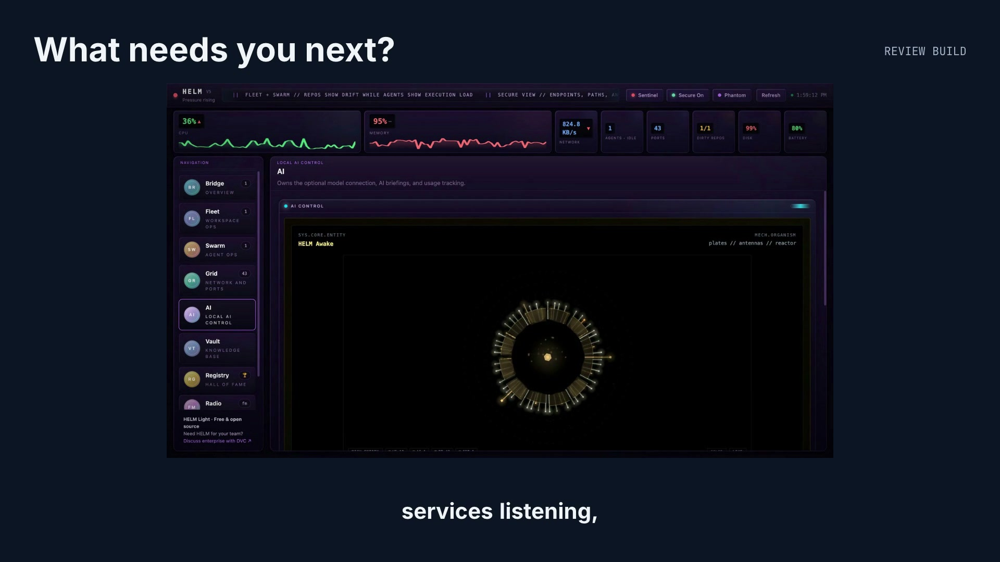
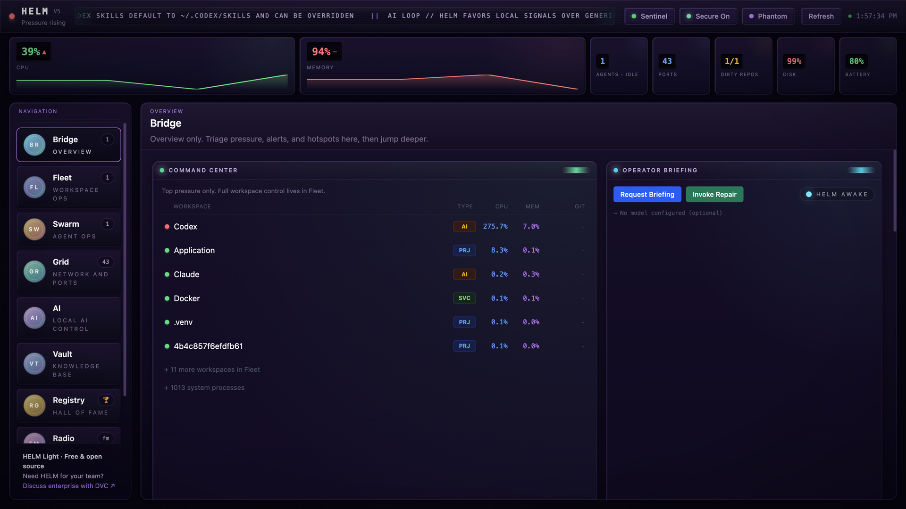
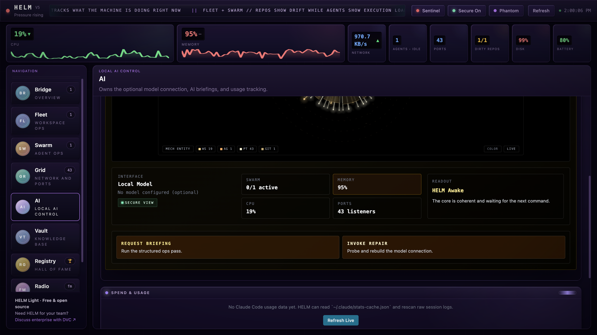
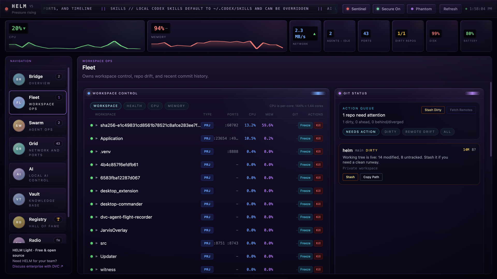

# HELM: Operator Shell for Local AI Systems

HELM is a desktop ops shell for developers running AI agents, local services, and multi-machine model workflows. It keeps overall system status visible while giving each domain its own page instead of forcing everything into one dense dashboard.

Current version: `6.0.0`. Helm Light is free and open source under [Apache-2.0](LICENSE).

[Product page, demo and roadmap](https://darkvectorcognition.ai/helm/).

## See HELM in use

[](https://darkvectorcognition.ai/helm/#demo)

[Watch the narrated demo on DVC](https://darkvectorcognition.ai/helm/#demo) · [Download the video (MP4)](https://darkvectorcognition.ai/media/helm/helm-demo.mp4).

The demo and screenshots show a review build based on `5.0.0`, including fixes that have not shipped. Dates in the demo are 2026 roadmap targets, not release promises. See the [roadmap and release status](docs/ROADMAP.md).

HELM is free and open source. [Support HELM](https://darkvectorcognition.ai/helm/#support) with an optional contribution.

Need Helm for your team? [Discuss enterprise with DVC](https://darkvectorcognition.ai/helm/#enterprise).

## What's new in 6.0

- **Supervised agent runs.** Start a bounded run for Claude Code, Cursor or Codex with an explicit workspace, permission mode and time limit. A returned result waits for your review. Run journals recover after a restart, and quitting HELM stops managed work.
- **Signal interface.** A graphite shell with clearer navigation and a full-width run workspace. Visuals pause when hidden and respect reduced motion.
- **Pinned AI model.** Briefings can use one named model from a compatible provider. Hosted briefings send CPU and memory totals only.
- **Optional support.** A Support HELM link sits beside the team enquiry link. Every feature stays free.
- **Signed Mac download.** The macOS DMG on the GitHub release is signed with a Developer ID and notarized by Apple.
- **Windows executable name.** The Windows app is now `helm-light.exe`, so it does not collide with the Kubernetes `helm` command.

Windows managed launch is not available yet. Monitoring works on Windows. Details are in the [CHANGELOG](CHANGELOG.md).

## Download

Download the macOS DMG (Apple Silicon) from the [latest release](https://github.com/dark-vector-cognition/helm/releases/latest). Open it and drag HELM to Applications.

## What's new in 5.0

For anyone who cloned an earlier version:

- **Apache-2.0.** HELM moves from PolyForm Noncommercial 1.0.0 to the Apache License 2.0, so you can use, modify, and redistribute it, including commercially. See [LICENSE](LICENSE) and [NOTICE](NOTICE).
- **First run works without a model.** The app starts and every page renders with no model configured. AI briefings are optional and work with any OpenAI-compatible server (LM Studio, Ollama, llama.cpp, and others). With nothing configured, HELM only checks your own machine on the default port and never scans your network.
- **Electron 41.** Electron 35 to 41.10.7, with `better-sqlite3` 12.11.1 and refreshed build tooling. Node.js 22.12 or newer is now required.
- **Fixes and platform work.** Windows code paths for the port, network, process, battery, disk, and firewall monitors, tighter agent detection, quieter notifications, and a guard so a blank remote vault host can never start an `ssh` call. Details are in the [CHANGELOG](CHANGELOG.md).

Auto-update remains a future packaging proposal. No delivery date is announced. See the [proposed roadmap](docs/ROADMAP.md).

## Quick Start (2 minutes)

New here? Paste [`docs/llm-setup-prompt.md`](docs/llm-setup-prompt.md) into your AI assistant for guided setup.

```bash
git clone https://github.com/dark-vector-cognition/helm.git
cd helm
cp .env.example .env
npm install
npm run dev
```

Requires Node.js 22.12 or newer. No model is needed to run HELM. If you want AI briefings, point it at any OpenAI-compatible server (see [Optional Model](#optional-model)).

## Screenshots

### Bridge



Machine load, warnings and the command center in one view. This capture has no model configured.

### AI



The AI page groups the optional model connection and briefing controls. The demo uses no configured model.

### Fleet



Workspace processes beside local repository status. This capture shows the `helm` repository on `main` with uncommitted changes.

## Navigation (9 Pages, Zero Panel Duplication)

Every panel appears on exactly one page. No duplicated widgets, no redundant noise.

| Page | What it does |
|------|-------------|
| **Bridge** | Mission control: command center, compact AI briefing, notifications |
| **Fleet** | Repo drift and process orchestration: workspaces, git status, commit history |
| **Swarm** | Agent operations: live agent state, swarm load, session timeline, HIVE control |
| **Grid** | Network and ports: scoped traffic topology and listening processes |
| **AI** | Optional model connection, AI briefings, Claude Code usage tracking |
| **Vault** | Search and browse an Obsidian vault through a vault-rag server, and push notes into it |
| **Registry** | Historical record: ranked agent archive, lineage, outputs, and lessons learned |
| **Radio** | FM streaming tuner with presets, local MP3 import, and direct URL loading |
| **Logs** | Live log tailing and system event stream |

Operator walkthrough: [docs/OPERATOR-WALKTHROUGH.md](docs/OPERATOR-WALKTHROUGH.md)

## Core Capabilities

- **Bridge** surfaces health, hotspots, command center, and the compact AI briefing
- **Fleet** handles repo drift, process orchestration, git status, and commit history
- **Swarm** discovers supported agent processes and shows task state from fresh agent reports. CPU use does not establish task state. See [agent support and Cursor setup](docs/AGENT-SUPPORT.md). HIVE can launch agents (analyst, architect, builder, ops)
- **Grid** exposes listening ports and scoped traffic topology
- **AI** centralizes the optional model connection, briefing requests, and Claude Code usage tracking
- **Vault** searches and browses an Obsidian vault through a local or remote vault-rag server, and can push notes into it
- **Registry** preserves impact-ranked agent history, lineage, stacks, outputs, and lessons learned. It starts empty on first run
- **Radio** plays public live streams with presets, search, custom URLs, saved volume and station state, and a mapped signal globe tied to your configured home endpoint
- **Logs** keeps live log tailing separated from operational controls
- **Sentinel** watches system state in the background and raises alerts from a set of configurable rules
- **SQLite persistence** stores snapshots, alerts, briefings, notifications, and log history locally

## Optional Model

The model is optional. HELM runs the same with or without one, and every page renders either way.

To turn on AI briefings, point HELM at any OpenAI-compatible server. No cloud inference is required.

- Set `LM_STUDIO_URL` in `.env`, or `lmStudioUrl` in `~/.config/helm/config.json`
- With nothing configured, HELM does not scan your network. `Request Briefing` only looks for a server on this machine at `http://localhost:1234` and otherwise shows a calm "No model configured" state
- Once an endpoint is configured, `Invoke Repair` probes it plus local and LAN-discovered fallbacks, and saves a repaired URL when it finds a healthy server. When an API key is set, it checks only the configured endpoint
- An API key belongs to the endpoint it was saved for: if a save changes `lmStudioUrl` without sending a new key, HELM deletes the stored key so it cannot be sent to a different host
- `LLM_API_KEY` applies only together with `LM_STUDIO_URL`, and it is sent only to that endpoint. Without `LM_STUDIO_URL`, or with one that is not a valid URL, it is ignored

For cross-machine setups, enable network serving on the model host and make sure the chosen port is reachable through the host firewall.

## Stack

Electron 41 · React 18 · TypeScript · Tailwind 4 · Zustand · SQLite (`better-sqlite3`) · Vite (`electron-vite`) · Vitest

Electron remains the pragmatic cross-OS shell here because HELM depends on desktop IPC, tray integration, local process inspection, filesystem access, and machine-adjacent monitoring.

## Configuration

Config file: `~/.config/helm/config.json`

| Option            | Default                 | Description                                         |
| ----------------- | ----------------------- | --------------------------------------------------- |
| `lmStudioUrl`     | unset (no model)        | OpenAI-compatible server URL for AI briefings       |
| `apiKey`          | unset                   | Optional API key for hosted endpoints, sent as `Authorization: Bearer <key>` to the configured URL only. `LLM_API_KEY` overrides it when `LM_STUDIO_URL` is also set. The key stays in the main process and is never sent to the UI |
| `gitRepoPaths`    | `[]`                    | Paths to monitor for git status                     |
| `monitorInterval` | `2000`                  | Monitor polling interval in milliseconds            |

Optional local override:

```bash
cp .env.example .env
# Paths in `.env` may be absolute, `~`-relative, or relative to the repo root.
# Example:
LM_STUDIO_URL=http://localhost:1234
HELM_GIT_REPO_PATHS=.,../shared-repos
```

## Skins

4 built-in skins, toggled with Cmd+Shift+S (Mac) / Ctrl+Shift+S:

- **Deck** - Dark gunmetal chrome, cool cyan accent
- **Orbiter** - Warmer chrome with teal-green accent
- **Forge** - Reactor gold on black, machine warmth
- **Phantom** - Deep violet neon on obsidian, night ops

## Testing

```bash
npm run typecheck
npm test
```

## Platform Support

- **macOS**: primary supported platform
- **Windows and Linux**: guarded monitor paths. Windows parsers for ports, network, processes, battery, disk, and firewall are covered by unit tests but have not been exercised on real Windows hardware. Some local monitor integrations remain macOS-first

## License

HELM is open source under the [Apache License 2.0](LICENSE). Copyright 2026 Dark Vector Cognition LLC. See [NOTICE](NOTICE).
